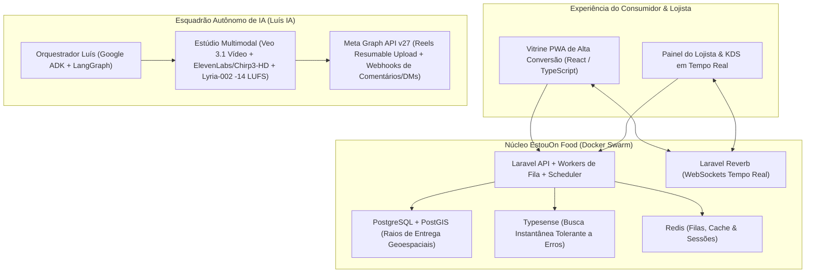

# 🍔 Case Study Arquitetural — EstouOn Food (SaaS Multi-Restaurante & IA Multimodal)

> **Nota de Governança:** Este repositório público documenta a arquitetura de engenharia do **EstouOn Food** (`estouon.app.br`). O código-fonte de produção é mantido em repositório privado.

---

## 🎯 Sobre a Plataforma

O **EstouOn Food** é uma plataforma SaaS Multi-Restaurante, Delivery e Cardápio Digital construída para eliminar taxas abusivas de intermediação sobre comércios locais (restaurantes, hamburguerias, food trucks, mercados e hortifrutis).

A plataforma combina uma arquitetura de **alta conversão e baixa latência** com um **Esquadrão Autônomo de Marketing e Atendimento por IA (`Luís IA`)** que produz campanhas multimodais (Reels em vídeo, carrosséis e locuções) e responde clientes em tempo real no Instagram e WhatsApp.

---

## 🏗️ Arquitetura de Produção & Diferenciais Técnicos

### Engenharia de Destaque
- **Cálculo Geoespacial com `PostGIS`:** Validação precisa de polígonos e raios de entrega com indexação espacial para cálculo instantâneo de frete.
- **Busca Instantânea com `Typesense`:** Indexação de cardápios e catálogos multi-loja com resposta sub-50ms.
- **Operação em Tempo Real (`Laravel Reverb`):** Atualização instantânea de status de pedidos da cozinha até o cliente final sem *polling* HTTP.
- **Marketing & Atendimento Autônomo (`Luís IA`):** Agente de domínio dedicado com personagem 3D próprio, direção criativa multimodal segmentada por nicho, armazenamento em **Cloudflare R2 (`S3v4`)** e *LLM-as-a-Judge* para conformidade publicitária.

---

## 🛠️ Stack Tecnológica

